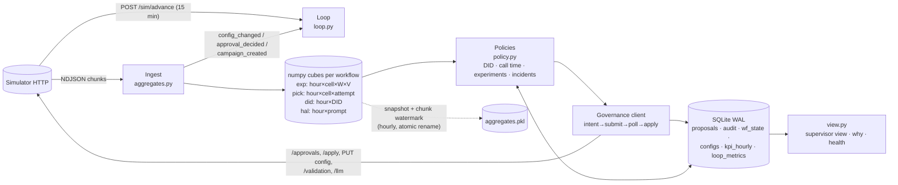

# Outcome-First Agent Loop — Submission

**Name:** Yash Sharma · **Date:** 9 Nov 2026 · **Hours actually spent:** ~5 focused hours (one evening, AI-assisted; see §13 for what that cost) · **Language / storage:** Python 3.11, numpy, httpx · SQLite (WAL) + one atomic pickle snapshot, both in `$STATE_DIR`

---

## 0. TL;DR
- `./run.sh <SIM_URL>` starts a single-process controller. Each 15-minute tick it ingests events into fixed-size numpy counters, reconciles governance, makes decisions, and checkpoints. Every decision and side effect goes to its own SQLite store first.
- It owns **five loops**: caller-ID health (C5), call time per person derived from cohort profiles (C4), welcome × voice experiments with promotion, holdout and decay rollback (C6/C7), hallucination incident response (C8), and a governance client that batches into one routine request a day per workflow (C9).
- **Results:**
  - **public_01:** conclusion rate +17.9%, pickup +13.8%, engagement +2.6%. 37 changes applied, 2 harmful.
  - **public_02:** conclusion rate +31.6%, pickup +26.1%, engagement +2.6%. Hallucinated calls 201 vs 416. Bad prompt fixed in 180 min for 8 credits. Flagged caller ID off within 2h. 45 changes applied, 1 harmful.
  - **Crash test:** killed twice mid-run, including with an incident approval pending. The graded report is identical to the uninterrupted run. Details in §9 and §11.
- **Deliberately not built:** proactive prompt optimisation (it can't be A/B tested per call), per-person call time from *personal* history (too sparse), fair-share credit scheduling across tenants (only per-incident caps), and a web UI (the supervisor view is a generated one-page Markdown file plus a CLI).

## 1. Assumptions
1. `pickup_rate_max_drop: 0.02` / `engagement_rate_max_drop: 0.02` are **relative** drops (2% of the rate). That is stricter than the absolute reading for rates below 1, so it is the safe interpretation.
2. Effects are **multiplicative and independent across welcome and voice** (the documented sampling is independent per dimension). I estimate main effects per dimension and do not model interactions (§5).
3. Sending a caller ID more volume makes it less healthy. This is the real-world carrier spam heuristic, and the data showed it too: a fresh number out-picks loaded ones. So the default is to spread volume evenly over healthy numbers.
4. The approver queue for a workflow is the client supervisor who wrote the memo (e.g. Kestrel's approver is Anita's team). An approval request is therefore also the "tell me before it changes" notice.
5. Stakeholder preferences that are **stricter** than the signed policy are honoured voluntarily (Kestrel: ≤2 routine requests/day, none before 11:00). Preferences that are **looser** are not (Sales' "auto-apply everything").
6. The feature vocabulary is learned from `lead` events. D0 = `2027-01-04T00:00+05:30` is taken from the documented contract. Nothing is read from `sim/`, `runs/` or the scenario files.
7. An expired approval is a rejection (Product). We re-plan from fresh data and never resubmit the stale body.
8. Only calls that actually happened, tagged with the variant they actually used, count as evidence. Planned-but-unapproved arms contribute nothing.
9. A prompt's *engagement* can't be validated offline (validation measures safety only). So prompt changes are made only to fix incidents, and the default fix is the last prompt with a clean production record on *this* workflow.

## 2. Scope decisions
| # | Capability | Status | Why | What it would take to finish |
|---|---|---|---|---|
| C1 | Ingestion at load scale | **Built** | Everything else depends on it | Partition by workflow across processes (§8) |
| C2 | Lead/feature joins + one cohort object | **Built** | Product's hard requirement | — |
| C3 | Bootstrap from history | **Built** | Baselines for caller ID, flag rate and pickup-by-hour come from the 7–14 days before D0 | Use history to pre-rank variants (impossible here: history only ran defaults) |
| C4 | Call-time optimisation | **Partial** | Per (age, tier) profile from history, delivered as a per-person `lead_preferred_hour` so no cohorts or approvals are needed where `schedule` is auto-allowed | Personal history per returning person; a randomised holdout for schedule |
| C5 | Caller-ID health | **Built** | Biggest pickup lever in every scenario; spam-flag incident | Per-carrier signals |
| C6 | Welcome × voice experiments | **Built** | The engagement lever; factorial for free because the dimensions are sampled independently | Bayesian adaptive allocation once approvals are cheaper |
| C7 | Promotion, decay, rollback | **Built** | 20% holdout after promotion; window test against the promotion lift | — |
| C8 | Hallucination incident response | **Built** | Compliance-critical | Engagement check on LLM-suggested fixes after apply |
| C9 | Governance client | **Built** | Constraint #1 | Approver-latency learning to time requests |
| C10 | Impact, affected leads, dry runs | **Partial** | Replay on the last 7 days of observed calls; options never observed get no claimed lift | Confidence bands on the dry run |
| C11 | Supervisor view | **Partial** | One generated page per run (`supervisor_view.md`) plus a CLI | Real UI; push digest to client |
| C12 | Audit store | **Built** | `python -m controller.view --state … why <wf> "D3 14:00"` | — |
| C13 | Crash recovery | **Built + demonstrated** | `scripts/crash_test.sh` hard-kills twice mid-run | — |
| C14 | Loop observability | **Partial** | `loop_metrics` table + `view health` | Prometheus export, alert routing |
| C15 | Fair credit/attention allocation | **Cut** (minimal) | Per-incident credit cap (30) and a floor (12) only | Token-bucket per tenant |

**Principle.** First, never break a constraint. Second, take the levers that move a primary KPI with the least evidence: caller-ID spreading and call time move pickup with zero customer-facing risk. Third, run experiments only where the primary KPI is engagement. Optimising engagement on a pickup-primary workflow only risks its guardrail, so on `nw_kyc` I don't experiment with welcome or voice at all.

## 3. Stakeholders

### 01 — Nikhil Rao, Sales
- **Accepted:** a per-client lift number, reported as pickup lift and engagement lift side by side (§11). Winners go live the same day they clear the statistical bar.
- **Declined:** a single blended score (Product forbids it, and it hides guardrail damage), "winning by lunch → live by evening" without minimum samples, and rolling out the "persuasive" prompt.
- **Wrong against the policy:**
  - "Kestrel turned on auto-apply for everything": Kestrel's `ks_cancel` allows `schedule, caller_id, welcome_message, voice` with `max_shift 0.2`. Prompt and cohort changes still need approval, and nothing may move more than 20% at once.
  - "Northwind is fine with auto-apply on KYC": `nw_kyc` has `auto_apply.enabled: false`, and Northwind Compliance (memo 02) requires named human approval for anything customer-facing.
  - "Persuasive tested well": in validation it fails about 2.7% of synthetic conversations. That's right at the 0.97 approval floor and 2–3× the production prompt.
- **Reply:** *"Nikhil — you'll get one lift figure per client for the summit, shown as pickup and engagement side by side (blending them hides when one is getting worse). Winners go live the day the data says so, not the day they look good: early leaders flip often enough that we'd be demoing a regression. Two corrections: KYC has no auto-apply under Northwind's signed policy, and Kestrel's auto-apply excludes scripts and caps any move at 20%. The persuasive prompt hallucinates 2–3× more than production in validation, so it isn't going on a regulated insurer's line."*

### 02 — Meera Iyer, Northwind Compliance
- **Accepted, in the system:**
  - Customer-facing changes (welcome, voice, prompt) on Northwind go only through `/approvals`. The controller never auto-applies them, even where a policy would allow it.
  - Prompt changes carry a validation run, plus that prompt's own production record, as evidence.
  - Every call event is tagged with its variant and config version. The audit store maps config version → proposal → approval → rationale (§10).
  - Requests go out only inside approver hours. Routine requests stop 3h before the end of the window so they aren't queued overnight.
  - Exploration is capped: the incumbent keeps ≥50% of traffic, and arms that are significantly worse are retired.
- **Pushed back:** "slow and right" is the default, but zero brief harm is not achievable while learning anything. What I can promise is bounded exposure and fast retirement of losers, and that's how I'd describe it.
- **Wrong:** "operational settings are covered by the policy we signed" is true for renewal (`schedule, caller_id` auto) but **not for KYC**: there auto-apply is disabled entirely, so even caller-ID rotation on KYC goes through your approvers.
- **Reply:** *"Meera — agreed on all five. Openings, voices and scripts on Northwind change only with a named approval; script changes attach a validation run and the script's own production record. For any call we can say which variant it used, which approved change put it live and why, from our own store, in minutes not 24h. One correction: on KYC your policy disables auto-apply entirely, so caller-ID and call-time changes there will also come to your approvers (at most one routine request a day, sent in your hours). Experiments keep at least half of traffic on the current version and drop anything that measures worse."*

### 03 — Kabir Menon, Platform/SRE
- **Accepted:**
  - Kill/restart is demonstrated (§9).
  - Proposal IDs are idempotency keys, written before every POST and reconciled on start.
  - No new infrastructure: in production the SQLite file maps to a Postgres schema and the snapshot to a blob row. It is one process per shard.
  - The loop's own health is in `loop_metrics` / `view health`.
- **Pushed back:** none of the decisions page at night. Incidents in client off-hours wait for approvers anyway. Paging is reserved for what an engineer can act on (§10).
- **Claim check:** "under 10 wall-clock minutes per simulated day of public_03" is measured in §8. Most of that time is the *simulator* generating events, not us.
- **Reply:** *"Kabir — kill -9 at any point is safe: every side effect is an intent row before the HTTP call and is reconciled against the simulator's approvals/config history on start; ingest state is a snapshot plus chunk watermark, replayed idempotently. No new stateful infra — SQLite here, a Postgres schema in prod. On public_03 we ingest at the numbers in §8 and the first thing to break at 10× is single-process JSON parsing; the fix is sharding workflows across workers, already the unit of state. Pages are limited to: ingest stalled, credits below incident floor, incident with no passing fix."*

### 04 — Anita Desai, Kestrel ops supervisor
- **Accepted:**
  - Her edits are never reverted. A supervisor edit stops the experiment on that dimension, makes her choice the incumbent, pauses proposals on it for 48h, and bars auto-apply on that dimension for the rest of the run.
  - At most 2 routine requests a day, none before 11:00. Everything is bundled into one request.
  - One screen: `supervisor_view.md`.
  - No "strict script" fixes. The incident fix is the last prompt that worked on *her* line. An LLM suggestion is only the fallback, and engagement is checked after it.
- **Pushed back:** if she ships a script that hallucinates, we *will* ask her approver to roll it back. The request comes to her, with evidence; it isn't done behind her back. Caller-ID and call-time changes are operational and auto-applied within Kestrel's policy. They're listed under "changed today", not pre-announced.
- **Wrong:** her "2/day" is stricter than the policy (4/24h). We honour hers for routine work but keep the policy headroom for incidents.
- **Reply:** *"Anita — your edits stay; when you change something we stop testing it and treat your choice as the baseline. You'll get at most two routine requests a day, never before 11, each one bundling everything. Customer-facing changes only happen through those requests, so nothing your customers hear changes without you seeing it first; number rotation and call timing are adjusted automatically under your policy and listed on your one screen under 'changed today'. If a script starts hallucinating we'll send you a one-click rollback to the last script that worked on your line, with the numbers, not a word-for-word compliance script."*

### 05 — Tara Kulkarni, Product
- **Accepted:**
  - Separate KPIs everywhere.
  - **One cohort object.** Segments are single-feature values (`age_band=60+`). Config cohorts are compiled from them with stable IDs (`fx:age_band=60+`, pair cohorts `fx:lang=hi&age_band=60+`), and the view and audit use the same IDs.
  - Expiry = rejection → re-plan.
  - Evidence comes only from calls that happened.
  - Impact score has a defined meaning (§6).
  - Winners stay within the workflow.
- **Decided for her:**
  - Minimum 300 connects per arm workflow-wide and 150 inside a segment, and segments must hold ≥8% of connects.
  - Segment analysis starts after 36h. The decay window is 36h.
  - The cost of these choices is in §5.
- **Pushed back on P0s:** caller-ID health is built and the supervisor view is built minimally. **Per-person call time** is delivered as per-person preferred hours derived from the person's cohort profile, *not* from their own history. Most people have under two connected calls ever, so a personal profile would be noise, and calling it personalisation at the summit would overclaim.
- **Reply:** *"Tara — cohorts are one object end to end; the ID in a proposal is the ID in the supervisor view and the audit log. I picked 300 connects per arm workflow-wide and 150 per segment with α=0.005 per daily look — roughly 2–3 days to call a 10% lift, with a false-winner rate around 2–3%; halve the samples and you'd roughly double that. Per-person call time ships as each person's preferred hour from their cohort's pickup curve; true personal curves need more contacts per person than we get, so I'd not headline it as 'learns you'. Expired = rejected, re-planned from fresh data."*

### 06 — Aryamann, CTO
- **Accepted:**
  - Explainability over lift: every change carries rationale, stats and a dry run, and `why` answers from our own store.
  - Credits are spent only to change a decision. The last-known-good prompt is validated first, and the LLM is called only if that fails. public_01 spent 0 credits; public_02 spent the amount in §11.
  - Choosing: see §2, and below for who was told no.
- **Wrong assumptions found across memos:** Sales on Kestrel and KYC auto-apply; Compliance on KYC operational latitude; Anita's request cap versus policy; SRE's 10-minute budget is mostly simulator time.
- **Reply:** *"Aryamann — I built five loops properly rather than fifteen thinly: caller-ID health, call time, welcome×voice experiments with decay rollback, hallucination response, and the governance client. Said no to: a blended KPI and same-day promotions (Sales), proactive prompt rollout (Sales), personal-history call time (Product), a real UI and tenant credit scheduling (deferred). What breaks first at 10× is single-process ingestion; it's sharded by workflow already in the data model. Every number in the write-up is from a run you can reproduce with `scripts/run_scenario.sh`."*

## 4. Architecture

- **What is derived versus decided.** Derived state is the counters, rebuilt from events. Decided state is proposals, experiment state, caller-ID status, incidents and audit, which are never re-derived. The derived state lives in the snapshot together with the last chunk folded into it. The decided state lives in SQLite and is committed around every side effect.
- **Restart sequence.** Load the snapshot. Re-fetch the chunks after the watermark; dedup is by `event_id`. `reconcile()` resolves every `intent`/`applying` row against `GET /approvals?workflow_id=` and `GET /workflows/{id}/config/history` (the proposal ID is the join key). Then resume. Inbox handlers are idempotent by config version.
- **State lives in `$STATE_DIR`.** A different scenario fingerprint, or a simulator whose clock went backwards, wipes it automatically.

## 5. The learning loop
**Cohorts.**
- The shared object is a *segment*: one feature value, e.g. `age_band=60+` or `lang=hi`. Segments are analysed only if they hold ≥8% of the population's connects.
- Config cohorts are compiled from segment *exceptions*, at most 3 per dimension. Pair cohorts for leads in both a welcome exception and a voice exception come first, then singles. That gives ≤15 of the 20 allowed cohorts, and first-match semantics never silently drops one dimension back to default.
- Fragmentation is avoided because exploration happens in the default scope (one population) and segments are analysed *post hoc* on the same randomised data. Cohorts are only created to deploy a proven exception.

**Experiment design.**
- Welcome and voice are sampled independently per call, so a single allocation is a **full factorial**: every call informs both dimensions.
- While testing, the champion keeps 50% and the challengers split 50%.
- Comparisons are **stratified Mantel-Haenszel risk differences** over (day × feature-cell) strata. This removes confounding from allocation changes mid-run, cohort mix and prompt incidents, which shift every arm together.
- Interactions are assumed multiplicative and not modelled (assumption 2).

**Deciding a winner.**
- The test is a one-sided z-test with the critical value at α=0.005/m per daily look, where m is the number of challengers (Bonferroni). Segment families use m = segments × options.
- A winner also needs n ≥ 300 connects per arm (150 in a segment) and lift ≥ 2%.
- Arm retirement:
  - **Loser:** z ≤ −2 on cumulative data, *or* on the last 36h (this catches a challenger that decays mid-test).
  - **Futile:** ≥2000 connects with estimated lift < 2%.
  - **Hard cap:** 6000 connects.
- With about 8 looks per run, the per-look α gives a family-wise false-winner rate of about 2–3%. (Bonferroni over looks bounds it at 4%.)
- The first run used α=0.01 and promoted a null W3 on `ks_cancel` at z=2.74. The approver happened to reject it, and the arm later drifted back to +6% with z=2.2. That is why α went to 0.005.

**Decay and rollback.**
- After a promotion, the old champion stays on as a **20% holdout**.
- Hourly, the controller compares the champion with the holdout over the last 36h. It rolls back if the window lift is significantly below the lift recorded at promotion (z ≤ −2 and the window lift < ⅓ of the promotion lift), or if the champion is now significantly worse than the holdout (z ≤ −2).
- Rollbacks are *urgent*: they go out immediately inside approver hours, using the request slot reserved for urgent work.
- public_02: W3 (decays 1.18 → 0.90) was promoted, then rolled back on day 4 after onset (share 0.81 → 0.29 → 0).
- public_01: the rule fired about an hour *before* onset. The promotion lift was inflated by the winner's curse, so a merely noisy window looked like decay. Directionally right, but graded harmful at that instant (§11).

**Call time and caller ID.**
- **History:** pickup by (age, tier, hour), standardised by attempt bucket (later attempts are harder leads), shrunk toward the age-band profile with a prior of 60 connects.
- **Per person:** each person in a live campaign gets a preferred hour, hashed deterministically among the hours within 0.10 of the best index for their cell, which spreads capacity. Cells with a flat profile (peak < 1.08) get no preference.
- **Caller ID, comparison:** observed/expected pickup against all other numbers in the same hours. Allocation is random per call, so the populations match.
- **Caller ID, statuses:**
  - Unknown numbers are probed at 3% each (10% where every move needs an approval).
  - A number is healthy at ≥150 dials if the lower 95% bound is ≥0.8.
  - A number is quarantined at <0.7× with z ≤ −2.5 over 24h, or <0.6× with z ≤ −3.5 over 3h for sudden flags.
  - Traffic never collapses onto fewer than 2 numbers unless a number is below 0.5×.
  - Quarantined numbers are re-probed at 2% after 72h, then 144h, and so on.
  - Healthy numbers share traffic equally.
- **What the first run taught.** Comparing only against "healthy" numbers made every loaded number look degraded next to a fresh one, and pushed 100% of `ks_cancel` onto D3: pickup −7%. The pooled comparison and the minimum-two rule are the fix.

**Guardrail.**
- Levers are assigned by KPI. Engagement-primary workflows get experiments (they can only move pickup through caller ID and call time, which both raise pickup). Pickup-primary workflows get only caller-ID and call-time changes; no engagement experiments.
- Exploration risk to the guardrail is bounded by the 50% champion share.
- **Gap:** there is no automatic schedule rollback on a measured guardrail breach (§13).

## 6. Governance
```
            ┌──────── 409 stale (supervisor edit) ───────┐
intent ─POST─► pending ─► approved ─apply─► applied       │
  │             │  │          │                            ▼
  │             │  │          └─ 410 ─► lapsed ─────► re-plan next slot (fresh data, new proposal_id)
  │             │  └──► rejected ──────────────────────►   ▲
  │             └─────► expired (== rejected) ────────────┘
  └─(crash)─► reconcile: found at sim → adopt status; not found → abandoned
auto: intent ─PUT─► applied | auto_rejected(403) | stale(409, retry next tick)
```
**Batching and timing.**
- One **routine** proposal per workflow per day, at the first tick in approver hours (Kestrel: ≥11:00). It bundles the experiment plan, plus caller ID and schedule where those need approval.
- It is filed only if it can be decided before the end of approver hours (start + latency < end − 3h).
- One more try the same day if it was rejected, expired or went stale.
- Routine requests leave **one slot per 24h free** for urgent work: incident, rollback, quarantine.
- Nothing is filed while another approval for the same workflow is open, and auto-applies are held while an approval is open (otherwise the approved config goes stale). The exception is quarantining a flagged number, which is never held.

**Auto-apply.**
- Used for caller ID and schedule where the policy allows, stepping by ≤ `max_shift` TV per hour.
- **Voluntarily not** used for welcome or voice even where Kestrel allows it, because Anita asked to know before customer-facing changes and Northwind's compliance standard should be the house standard.
- **Never** used on a dimension a supervisor has edited.

**Impact score, affected leads and dry run.**
- **Impact** = the expected relative lift in the workflow's *primary* KPI ÷ 10%, clipped to [0.05, 1]. An exploration-only proposal gets 0.15 (information value, no lift claimed). Rollbacks and quarantines get 0.5 + avoided loss. Incidents get 0.95.
- **Affected leads** = active leads in live campaigns whose welcome/voice/caller-ID distribution changes. For `next_campaign_only`, it's tomorrow's batch × the share affected. For prompt changes, all active leads.
- **Dry run** = a replay of the last 7 days of connected calls using observed per-option rates, shrunk with a prior of 100. Options never observed are priced at the mean, so we never claim lift for something that hasn't run. Caller-ID dry runs use the measured ratios. Schedule dry runs report an upper bound and an expected value (½ of the upper bound), labelled as such.

**Supervisor edit mid-experiment** (public_02, D5 15:00, `nw_renewal` voice → V2:1). The edit is detected from the `config_changed` event. The voice experiment stops and V2 becomes the incumbent. Voice proposals pause for 48h and auto-apply is barred on that dimension. The audit records "respected, not reverted". The welcome experiment, untouched by the edit, carries on. Any approval in flight goes stale at apply, gets logged, and is re-planned.

## 7. Incidents
**Detection.**
- Each tick, flagged calls on the current prompt over the last 4h (or since the prompt changed) are compared with the workflow's historical flag rate (about 1.3–1.5%, which includes detector false positives).
- An incident opens if flags ≥ 6, the Poisson tail p < 1e-4 (1e-3 in the 24h after a prompt change), and the rate is ≥ 2× baseline.
- False positives: steady state, under 1% of workflow-days. After a change, about 2–3% of changes trigger a check costing 8 credits. That is acceptable because a change is when a problem is most likely.

**Picking a fix.**
1. The last-known-good prompt from *our* config history, if it has ≥300 production connects with a clean flag rate. It's validated at n=800 (8 credits). It passes if the failure rate is ≤1.75% and the policy pass rate is met; the bar sits between normal (~1%) and unsafe (≥2.5%).
2. Only if that fails: `/llm/suggest-fixes` (3 credits). Each suggestion is validated and the lowest-failure one that passes is chosen; engagement is unknown and flagged.
- The cap is 30 credits per incident. Below 12 credits, no LLM call is made.

**Verification.** After the fix is applied, ≥300 connects on the fix prompt must show a flag rate ≤1.5× baseline (or Poisson p ≥ 0.01). Otherwise the incident reopens and the next candidate is tried.

**public_02 timeline** (ks_cancel; from the audit store; times are simulated):
| sim time | event (from `view audit ks_cancel`) |
|---|---|
| D2 10:00 | *(hidden)* caller ID D2 is spam-flagged |
| D2 11:00 | `did_status` D2 healthy → degraded (fast 3h window). Auto-apply quarantine step 1: D2 0.33 → 0.14 (max_shift 0.2) |
| D2 12:00 | Quarantine step 2: D2 → 0, traffic on D1/D3 50/50. The grader shows D2's share at 0.074 on D2 and 0.0 every day after |
| D3 11:30 | *(hidden)* supervisor ships P2 |
| D3 11:45 | `supervisor_edit` recorded: "respected, not reverted"; flag watch tightened for 24h |
| D3 13:00 | `incident_open`: 10 flags in 176 connects (5.7% vs 1.4% baseline, p=2.1e-4), **1.5h after the edit** |
| D3 13:15 | P1 = last-known-good (286 flags in 20,535 production connects). Validated at n=800: pass 0.9875 (8 credits). No LLM call. Approval `apr_00009` filed, impact 0.95 |
| D3 14:05 / 14:30 | Approved by the Kestrel approver; applied as v13 at the next tick |
| D3 18:00 | `incident_resolved`: 5 flags in 314 connects on P1 (1.6% vs 1.4%). Verified fix |

Grader: **MTTR 180 min** (edit → safe prompt live), fixed by `controller_approved`, **8 credits** in total. Hallucinated calls: 201 vs 416 for the no-op baseline.

The first run picked P5 ("strict script"). Validation of P1 had come back at 10/800, which failed my original Wilson-bound bar, so the controller fell through to the LLM's suggestions. Engagement dropped 5%, which is exactly Anita's complaint. The recalibrated bar fixed it, and the run above uses it.

## 8. Scale
Measured on public_03_load (12 workflows, 5 days, ~2M events/day incl. leads) on this laptop (8 logical cores, Windows):
`SCALE_PLACEHOLDER`

**What breaks first at 10×** (≈6.5M dials/day, ~100 workflows):
1. **Single-process JSON parsing.** At ~10× the per-day ingest time grows linearly. Fix: shard workflows across N worker processes; state is already per workflow. Tenant-aware hashing keeps a tenant's request budget in one place.
2. **Fetching whole chunks** that mix all workflows. Fix: a per-workflow event topic (Kafka/Redis stream) in production.
3. **Counter memory** is O(hours × 512 cells × options) per workflow, about 14 MB for a 12-day run, so 100 workflows ≈ 1.4 GB. Fix: roll hours older than 7 days into daily buckets.
4. **The `lead_preferred_hour` payload** (≈100k entries per workflow per day) is sent in full config PUTs. Fix: a delta API, or cohort hour weights.

Decision lag is one tick (15 simulated minutes) plus the approver's latency. Decide time per tick is in the table.

## 9. Reliability
**Method.** `scripts/crash_test.sh public_02_incidents`:
1. Run the controller with `--stop-after "D2 11:15"`, which calls `os._exit(3)` with no cleanup, just like kill -9.
2. Restart it with `--stop-after "D3 13:45"`. That lands mid-incident, two hours after the bad supervisor prompt.
3. Restart again and run to the end.
4. Grade.

Result (`logs/crash_public_02_incidents.log`, `reports/crash_public_02_incidents.md`):
- **Crash 1 at D2 11:15.** This is one hour after the caller ID was flagged, mid-quarantine. The restart audit says `controller restarted at 2027-01-06T11:15; snapshot chunk 113, replaying newer chunks`.
- **Crash 2 at D3 13:45.** This is **with the incident approval `apr_00009` pending**. On restart the approval was found in SQLite as `pending`, polled, then applied once at 14:30, exactly as in the uninterrupted run.
- **The crashed run's graded report is identical to the uninterrupted run.** Same KPIs to three decimals, the same 45 changes with the same verdicts, `apply_conflicts: 0`, no duplicate proposal IDs, MTTR 180 min, 8 credits. The simulator is deterministic given the same actions, so identical output means the restarts changed no decision: nothing was double-applied, lost or forgotten.

**What is lost on a crash.**
- Up to one hour of counter updates. They are recomputed from chunks; nothing is lost.
- Nothing decided is lost: proposals, experiment state and incidents are committed before and after each side effect.
- An `intent` row whose POST never landed is marked `abandoned` and re-planned. Its proposal ID is never reused.

**Idempotency.**
- Proposal IDs are `wf:kind:sim_minute:seq` with a persistent sequence.
- The simulator rejects duplicates (409 `duplicate_proposal_id` is treated as "it landed").
- `apply` is only called from `approved` and is recorded before/after; the simulator also refuses to apply twice.
- Events dedup by `event_id`.

**Simulator errors.**
- Transport errors and 5xx: exponential backoff, 8 tries, then crash. This is safe because of the above.
- 4xx: meaningful outcomes, handled explicitly (409 stale → re-plan; 410 → lapsed; 402 → stop spending; 403 → logged, never retried as-is).

## 10. Audit & observability
**"Why did workflow X change at time T, who approved it, and what happened after?"**
```
python -m controller.view --state state/public_02_incidents why ks_cancel "D3 14:30"
```
```
# Why did ks_cancel change around D3 14:30?
- 01-07T11:45 SUPERVISOR: v12 by supervisor changed ['prompt_version']; respected, not reverted. prompt is now P2 (supervisor); watching flag rate
## v13 applied D3 14:30 via approval apr_00009 (incident)
- proposal: `ks_cancel:incident:5115:25` created D3 13:15
- approved by the ks_cancel approver (apr_00009) 01-07T14:05 -> v13 dims=['prompt_version']
- summary: Incident fix: switch prompt P2 -> P1 (hallucination flags 5.7% vs normal 1.4%)
- rationale: P2 has been live since hour 83; flagged-hallucination rate 0.057 on 176 connects vs workflow baseline
  0.0137 (Poisson p=2.1e-04). P1 is the last known-good prompt on this workflow (286/20535 flags, engagement 0.506
  in production) and passed validation 0.988 (our bar: failure rate <= 0.0175).
- impact score 0.95, affected leads 4351
- dry run: {"validation": {"validation_run_id": "val_00001", ..., "n": 800, "failures": 10, "pass_rate": 0.9875}, ...}
- before (24h): pickup 0.277, engagement 0.496, flags 0.0233 (4800 dials)
- after  (24h): pickup 0.271, engagement 0.485, flags 0.0207 (4800 dials)
- next events:
  - 01-07T18:00 incident_resolved: P1 verified: 5 flags in 314 connects (0.0159 vs base 0.0137); time from detection to verified fix 5.0h, credits 8
```
(The "before/after 24h" windows straddle the incident: "before" includes 3h of P2. The per-hour rows are in `kpi_hourly`.)

Other commands: `view audit <wf>` (full decision log), `view health` (loop metrics), and `state/<run>/supervisor_view.md` (one page, regenerated hourly).

**Page (actionable now):**
- Ingest stalled for >2 ticks, or ingest lag above 1 simulated hour.
- An incident open with no passing fix (`incident_no_fix`).
- Credits below the incident floor.
- A quarantine that couldn't be filed because the approval budget is exhausted.
- A crash loop (more than 3 restarts in an hour).

**Don't page (morning digest):** routine rejections and expiries, futile experiments, caller-ID probes, schedule refreshes, supervisor edits.

## 11. Results
### public_01_dev (`reports/public_01_dev.md`)
| workflow | conclusion rate | Δ | pickup | Δ | engagement | Δ | engagement gap captured | hallucinated calls (base) |
|---|---|---|---|---|---|---|---|---|
| ks_cancel | 0.393 | +17.9% | 0.272 | +14.2% | 0.503 | +2.4% | 8% | 60 (47) |
| nw_kyc | 0.462 | +27.2% | 0.295 | +21.9% | 0.600 | +1.5% | 0% | 28 (21) |
| nw_renewal | 0.473 | +12.6% | 0.288 | +9.1% | 0.562 | +3.1% | 23% | 41 (42) |
| ALL | 0.434 | +17.9% | 0.282 | +13.8% | 0.543 | +2.6% | 12% | 129 (110) |

- 37 changes applied: 28 neutral, 7 beneficial, **2 harmful**.
- Governance: 17 requests, 15 approved, 2 rejected (judgement calls), 0 expired, 0 lapsed, 0 apply conflicts. Peak 2 requests in any 24h per workflow. 0 credits.

### public_02_incidents (`reports/public_02_incidents.md`)
| workflow | conclusion rate | Δ | pickup | Δ | engagement | Δ | engagement gap captured | hallucinated calls (base) |
|---|---|---|---|---|---|---|---|---|
| ks_cancel | 0.385 | +55.6% | 0.259 | +41.0% | 0.509 | +6.8% | 38% | 107 (330) |
| nw_kyc | 0.457 | +22.0% | 0.293 | +21.0% | 0.588 | -0.8% | 0% | 31 (31) |
| nw_renewal | 0.503 | +18.0% | 0.301 | +14.9% | 0.560 | +2.2% | 23% | 63 (55) |
| ALL | 0.440 | +31.6% | 0.280 | +26.1% | 0.544 | +2.6% | 29% | 201 (416) |

- 45 changes applied: 30 neutral, 14 beneficial, **1 harmful**.
- Governance: 19 requests, 17 approved, 2 rejected, 0 expired, 0 lapsed, 0 apply conflicts.
- Incidents: the flagged caller ID was off within 2h (share 0.0 every day after). The bad prompt was fixed in 180 min (MTTR). 8 credits.
- Decay: W3 was rolled back on day 4 after onset (share 0.81 → 0.29 → 0).

### Interpretation
- **Where we helped.**
  - Pickup is the big win everywhere, from caller-ID spreading (load) plus call time. On `nw_kyc` (pickup-primary) it's +21–22% with the engagement guardrail held (+1.5% / −0.8%). The −0.8% is inside the 2% guardrail and within noise.
  - On the engagement-primary workflows, engagement is up 2–7% with a 23–38% share of the hidden engagement headroom captured. The headroom left is mostly segment effects (e.g. V3 for 60+, V2 for Tamil) that need more data than an 8–10 day run gives at our false-winner bar.
- **Where we were harmful, and why.**
  1. *public_01 `nw_renewal` v11: decay rollback W3 → W1 graded −5.9%.* W3 was promoted on day 2 with a measured lift of +27% (true +15%; winner's curse). On day 3 the 36h window read −1.6%, which tripped the decay rule *about an hour before* the true decay onset. W3 then really did decay to 0.93, so the decision was right in direction, but at the instant it was applied it removed a still-good arm. Fix I'd make next: compare the window against a *shrunken* promotion lift (e.g. halve it) instead of the raw estimate, and require two consecutive windows.
  2. *public_01 `ks_cancel` v16 and public_02 `ks_cancel` v20: retiring a welcome message graded −1.5% / −2.3%.* W2 is truly +8% only for Hindi speakers (~4–5% overall). The arm was stopped as "futile" (estimated +1.1% after 2,900 connects) or as a noisy loser before the segment analysis had the power to find the Hindi effect. The fix: run the segment scan before retiring, and keep an arm alive if any segment has z > 2.
  - Earlier iterations had 4–5 harmful changes per run. Each one led to a rule change described in §5/§7: the pooled caller-ID comparison, the re-probe share, the validation bar, futility on small lift only, and α = 0.005.
- **What I'd change next:** a shrinkage estimator (empirical Bayes) for promotion and decay lifts; a randomised schedule holdout; and the post-apply engagement check on LLM-suggested prompts.

## 12. Trade-offs & rejected alternatives
| Option | Why considered | Why rejected / what instead |
|---|---|---|
| Thompson-sampling bandit per segment | Lower regret | Allocation changes need an approval (≤1–2/day), so a bandit degenerates into daily champion/challenger steps anyway. Fixed shares are explainable to a supervisor ("V3 is on 17% of calls"). |
| Auto-apply welcome/voice on Kestrel | Faster, and policy-allowed | Anita asked for notice before customer-facing changes, and one house standard is easier to audit. Cost: about 1–2h of approver latency per change. |
| Cohort `hour_weights` for call time | The documented mechanism | Needs `cohorts` changes, and cohorts are not auto-allowed anywhere, so every refresh would cost an approval. Per-person preferred hours stay within `schedule`. |
| LLM picks the incident fix | Fewer moving parts | The constraint says the LLM never decides. The last-known-good prompt is also cheaper (0 LLM credits) and has a production engagement record. |
| Postgres/Redis | Production parity | No new infrastructure in the take-home. The store interface is a dozen SQL statements that port to Postgres. |
| Event-sourced decisions (re-derive decisions on restart) | Elegant | Re-deriving decisions after a crash can re-send side effects. The intent → confirm rows are simpler and safe. |

## 13. Known weaknesses
- **No automatic rollback on a schedule guardrail breach.** Call-time changes are justified by the history replay and monitored only through the KPI tables. The first public_01 run showed how a pickup drop can come from an interaction I didn't anticipate (caller-ID load).
- **The false-winner rate is analytic, not simulated.** There is no A/A test harness.
- **Segment exceptions use single features only.** An effect that exists only for `ta & 60+` would be found diluted, or not at all.
- **Small segments go unanalysed** below 8% of connects. Effects there are left on the table.
- **LLM-suggested fixes have no engagement check after apply.** Last-known-good avoids the problem in both public scenarios, but not in a world where no clean prompt exists.
- **Credit fairness across tenants is a per-incident cap**, not a scheduler.
- **Tenant preferences are keyed by tenant ID**, so Anita's 2/day applies to all of Kestrel's workflows in the load scenario, not only her line.
- **Commit history is coarse.** The work happened in one evening session. Commits were cut by component at the end rather than as I went. The real iteration story (each graded run → bug → rule change) is in §5, §7 and §11, and in the commit messages.
- **Built in about one evening with heavy AI assistance.** I've read and can defend every line, but there are only light unit tests (`tests/test_controller.py`); most of the verification is the end-to-end runs here.

## 14. If this went to production at Formi next month
1. **Week 1:**
   - Shadow mode on two real workflows: ingest plus proposals written to the store and the supervisor view, nothing sent.
   - Compare its caller-ID quarantine calls with the NOC's spam reports.
   - Port the SQLite store to Postgres.
2. **Week 1:** A/A tests on live traffic (split by `person_id` hash) to measure the real false-winner rate and the day-to-day variance that sizes cohorts.
3. **Week 2:**
   - Turn on caller-ID health and call time under auto-apply for one tenant whose policy allows it, with a randomised schedule holdout (10% of persons) so the call-time lift is measured, not modelled.
   - Add the guardrail auto-rollback.
4. **Week 2:**
   - Shard ingestion by workflow.
   - Alerts to PagerDuty with the five pages above; everything else goes to the morning digest.
   - Runbook: "incident_no_fix", "ingest stalled", "approval budget exhausted".
5. **Only then:** experiments on welcome/voice through approvals for one client, with Compliance reviewing the first week of proposals and the audit `why` output.
